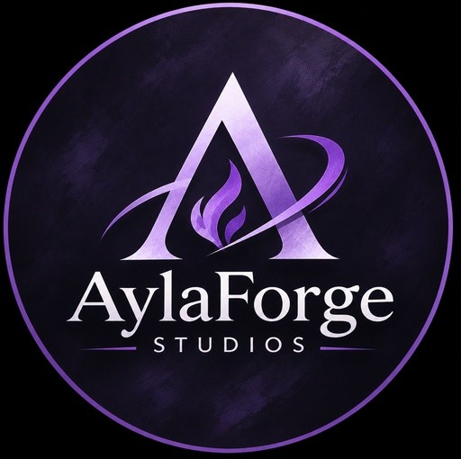

  

<h1 align="center">AylaForge Studios</h1>

  

Welcome to AylaForge Studios. We're an independent software and game development studio focused on creative projects, community tools, and bringing new life to legacy technology.

## Public projects

### [Crunchy in Old TV](https://github.com/AylaForgeStudios/crunchy-in-old-tv)

Our first public project is an unofficial community adaptation for older LG webOS televisions, based on Esteban Díaz's Crunchyroll WebOS Stream.

The private 2.2.5 milestone verified QR sign-in, profiles, catalog browsing, and episode playback with Spanish subtitles on an LG 55UJ6510-SA running webOS 3.5. The public source is in development. Its build requires a reviewed API provider, and no installable package is published.

## In development

- **QuestRecall Forever** — In development.
- **BANDERIX** — In development.

## Support the studio

[Support AylaForge Studios on Ko-fi](https://ko-fi.com/aylaforge). Contributions are voluntary and support development.
